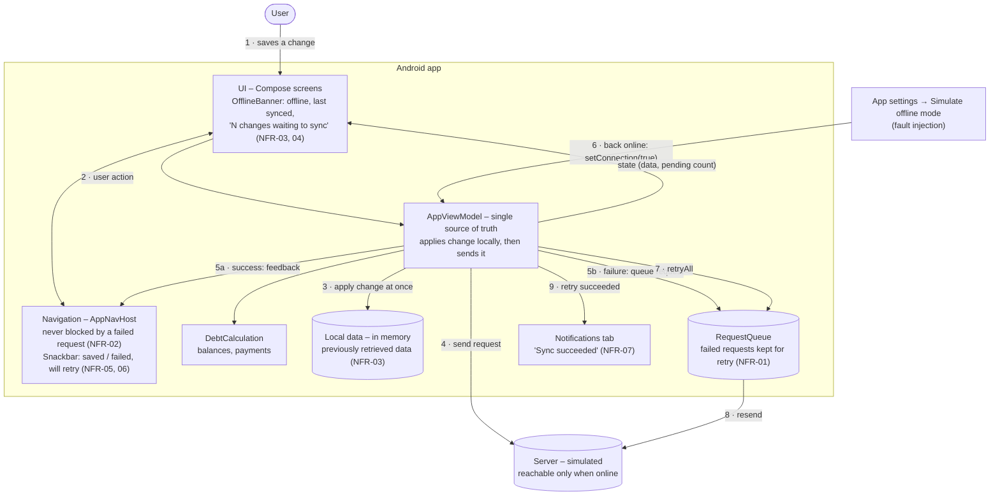

# Architecture – Reliability QA (NFR-01 – NFR-07)

This diagram shows how the application supports the Reliability QA: the main components and
how they interact when a request succeeds, fails, and is retried.

## Main components

| Component | File | Responsibility | NFR |
|---|---|---|---|
| UI – Compose screens | `ui/<feature>/` | Show data; the amber `OfflineBanner` shows offline status, last synced time and the number of changes waiting to sync. | 03, 04 |
| Navigation – `AppNavHost` | `navigation/AppNavHost.kt` | Moves between screens independently of requests; hosts the snackbar for request feedback. | 02, 05, 06 |
| `AppViewModel` | `data/AppViewModel.kt` | Single state holder. Every change is applied to local data first, then sent through `sync()`. | 02, 03 |
| Local data | `data/AppViewModel.kt` | In-memory groups, expenses, payments; stays readable offline. | 03 |
| `RequestQueue` | `data/RequestQueue.kt` | Keeps requests that failed and retries them in order when the connection returns. | 01, 04 |
| Notifications tab | `ui/notifications/` | Durable "Sync succeeded" entry after a background retry succeeds. | 07 |
| Server (simulated) | `AppViewModel.sendToServer()` | Accepts a request exactly when the app is online. | – |
| Simulate offline mode | `ui/profile/AppSettingsScreen.kt` | Fault injection: switches the simulated connection off and on. | – |

## Interactions – flow of one request

1. The user saves a change (e.g. an expense or a payment).
2. The screen calls `AppViewModel`.
3. `AppViewModel` applies the change to local data at once, so the app keeps working (NFR-02, 03).
4. It tries to send the request to the server.
5. a. **Online:** the request succeeds → snackbar "Expense saved" (NFR-05).
   b. **Offline:** the request fails → it goes into `RequestQueue` → snackbar "couldn't be sent –
   saved on this device, will retry automatically" (NFR-06), and the banner shows
   "1 change waiting to sync" (NFR-04).
6. The connection returns (`setConnection(true)`).
7. `AppViewModel` retries every queued request automatically, without user interaction (NFR-01).
8. Each request is resent to the server; those that succeed leave the queue.
9. If at least one retried request succeeded, a "Sync succeeded" notification is added to the
   Notifications tab, plus a snackbar (NFR-07).

## Limitations

- The server and network are simulated: "online" is the App settings toggle, not the device's
  real Wi-Fi or mobile data.
- Local data and the queue are kept in memory, so they are lost when the app is fully closed.
- There is no indicator while a request is in progress (the simulated server answers instantly);
  NFR-04 is covered by the "waiting to sync" count for queued requests.
- Payment screens (21–23) have no offline banner, as the navigation model excludes them from
  error-handling additions.

Tests: `app/src/test/java/com/example/myapplication/data/RequestQueueTest.kt`.
